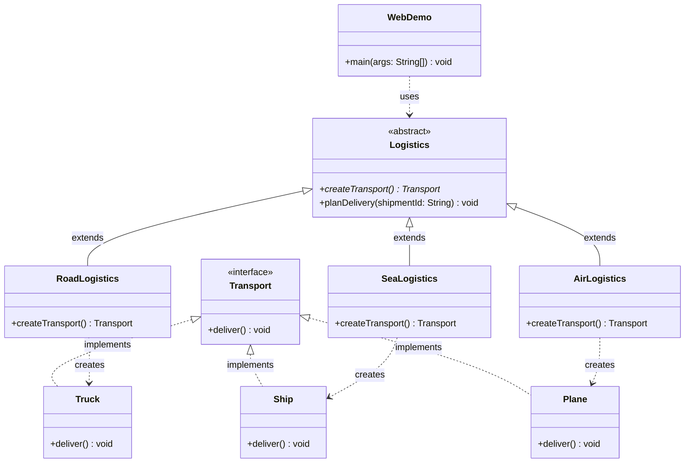

# BÁO CÁO THUYẾT TRÌNH: FACTORY METHOD PATTERN
### Chuẩn theo tài liệu [Refactoring Guru - Factory Method](https://refactoring.guru/design-patterns/factory-method)
> **Chuyên đề**: Creational Design Patterns  
> **Bài toán thực tế**: Hệ thống điều phối vận tải Logistics (Đường bộ: Truck, Đường biển: Ship, Hàng không: Plane)  
> **Giao diện Demo**: Web Local (`http://localhost:8080`)  
> **Thời lượng trình bày**: 3 - 4 phút  

---

## 1. Bối cảnh bài toán & Nguyên lý OCP

### 1.1. Bối cảnh theo Refactoring Guru
- Ban đầu, ứng dụng Logistics chỉ phục vụ vận chuyển bằng xe tải (**`Truck`**). Toàn bộ mã nguồn gắn chặt với lớp `Truck`.
- Sau đó, nhu cầu mở rộng sang đường biển (**`Ship`**) và hàng không (**`Plane`**).
- **Nếu dùng cách thông thường (Anti-pattern)**: Dùng chuỗi `if-else` và gọi `new Truck()`, `new Ship()` trực tiếp tại Client $\rightarrow$ Cứ mỗi lần thêm phương tiện mới lại phải mở code cũ ra để chèn thêm `else if`.

### 1.2. Hậu quả vi phạm nguyên lý thiết kế
1. **Vi phạm Open/Closed Principle (OCP)**: Class không đóng lại với việc sửa đổi, sửa code cũ dễ gây lỗi dây chuyền (regression bugs).
2. **Khớp nối chặt (Tight Coupling)**: Client phụ thuộc trực tiếp vào các class con cụ thể (`Truck`, `Ship`, `Plane`).

---

## 2. Sơ đồ lớp (Class Diagram) khớp 100% với Code

### 2.1. Sơ đồ Mermaid


### 2.2. Sơ đồ dạng ASCII Text (Tiện xem nhanh trên slide)
```text
          +----------------------------------------------+
          |            <<interface>> Product             |
          |                  Transport                   |
          +----------------------------------------------+
          | + deliver(): void                            |
          +----------------------------------------------+
               ^                     ^                  ^
               |                     |                  |
          (implements)          (implements)       (implements)
               |                     |                  |
+----------------------+ +---------------------+ +----------------------+
|        Truck         | |        Ship         | |        Plane         |
+----------------------+ +---------------------+ +----------------------+
| + deliver(): void    | | + deliver(): void   | | + deliver(): void    |
+----------------------+ +---------------------+ +----------------------+
               ^                     ^                  ^
               :                     :                  :
           (creates)             (creates)          (creates)
               :                     :                  :
+----------------------+ +---------------------+ +----------------------+
|    RoadLogistics     | |    SeaLogistics     | |    AirLogistics      |
+----------------------+ +---------------------+ +----------------------+
| + createTransport()  | | + createTransport() | | + createTransport()  |
+----------------------+ +---------------------+ +----------------------+
               ^                     ^                  ^
               |                     |                  |
           (extends)             (extends)          (extends)
               +---------------------+------------------+
                                     |
                     +-------------------------------+
                     |     <<abstract>> Creator      |
                     |           Logistics           |
                     +-------------------------------+
                     | + createTransport()*: Transp. |
                     | + planDelivery(id): void      |
                     +-------------------------------+
                                     ^
                                     : (uses)
                     +-------------------------------+
                     |        Web Client Demo        |
                     |            WebDemo            |
                     +-------------------------------+
```

---

## 3. Cấu trúc thư mục mã nguồn (Đã tinh gọn)

```
logistics-factory-method-demo/
│
├── README.md                      <- Báo cáo lý thuyết & Kịch bản thuyết trình
└── src/
    └── logistics/
        ├── Transport.java         <- [Product Interface] Khai báo deliver()
        ├── Truck.java             <- [Concrete Product 1] Xe tải chở hàng
        ├── Ship.java              <- [Concrete Product 2] Tàu container đường biển
        ├── Plane.java             <- [Concrete Product 3] Máy bay hỏa tốc (Minh họa OCP)
        ├── Logistics.java         <- [Creator Abstract] Chứa Factory Method createTransport()
        ├── RoadLogistics.java     <- [Concrete Creator 1] Khởi tạo Truck
        ├── SeaLogistics.java      <- [Concrete Creator 2] Khởi tạo Ship
        ├── AirLogistics.java      <- [Concrete Creator 3] Khởi tạo Plane
        └── WebDemo.java           <- [DUY NHẤT] File khởi chạy Web Server http://localhost:8080
```

---

## 4. Kịch bản thuyết trình 3 phút (Speaker Notes)

### ⏱️ Phút 0:00 - 1:00: Mở đầu & Sơ đồ lớp
* **Chiếu sơ đồ lớp** (trong README hoặc slide).
* **Nói**:
  > *"Em xin chào Thầy và các bạn. Sau đây em xin demo mẫu **Factory Method Pattern** qua bài toán kinh điển của **Refactoring Guru**: **Hệ thống điều phối Logistics**.*  
  >
  > *Nhìn vào sơ đồ kiến trúc:*
  > - *Phía **Product**: Interface `Transport` có hàm `deliver()`, hiện thực bởi `Truck`, `Ship` và `Plane`.*
  > - *Phía **Creator**: Lớp trừu tượng `Logistics` khai báo Factory Method `createTransport()`. Các lớp con `RoadLogistics`, `SeaLogistics`, `AirLogistics` sẽ quyết định phương tiện tương ứng.*  
  >
  > *Nhờ vậy, toàn bộ tầng điều phối và Client chỉ làm việc qua interface trừu tượng, loại bỏ hoàn toàn việc dùng `if-else` và `new` trực tiếp."*

---

### ⏱️ Phút 1:00 - 2:00: Mở code chỉ vào Factory Method
* Mở file **`Logistics.java`**:
  - Chỉ chuột vào dòng 17: `public abstract Transport createTransport();`  
    👉 **Nói**: *"Đây chính là **Factory Method**. Lớp cha không trực tiếp khởi tạo đối tượng cụ thể nào."*
  - Chỉ chuột vào hàm `planDelivery()`:  
    👉 **Nói**: *"Hàm xử lý đơn hàng gọi `createTransport()` để nhận `Transport` và gọi `deliver()`. Nghiệp vụ hoàn toàn độc lập với các lớp con cụ thể."*

---

### ⏱️ Phút 2:00 - 3:30: Chạy Web và Chốt hạ lợi ích OCP
* Mở file **`WebDemo.java`**, bấm **Run ▶️** (hoặc nhấn `Shift + F10`).
* Trình duyệt tự bật trang `http://localhost:8080`.
* **Thao tác trên Web**:
  - Chọn **Đường biển 🚢** $\rightarrow$ Bấm nút *"Thực thi Factory Method"*. Log hiện ra `SeaLogistics` sinh ra `Ship`.
  - Chọn **Hàng không ✈️** $\rightarrow$ Bấm nút *"Thực thi Factory Method"*. Log hiện ra `AirLogistics` sinh ra `Plane`.
* **Chốt câu ăn điểm**:
  > *"🎯 Điểm ăn tiền nhất của Factory Method là: Khi công ty muốn mở thêm tuyến đường hàng không `Plane`, ta chỉ việc tạo thêm class `Plane` và `AirLogistics`. **Toàn bộ code cũ của hệ thống không bị chỉnh sửa một dòng nào!** Hệ thống đạt chuẩn 100% nguyên lý **Open for Extension, Closed for Modification**!*  
  > *Em xin cảm ơn Thầy đã theo dõi!"*
